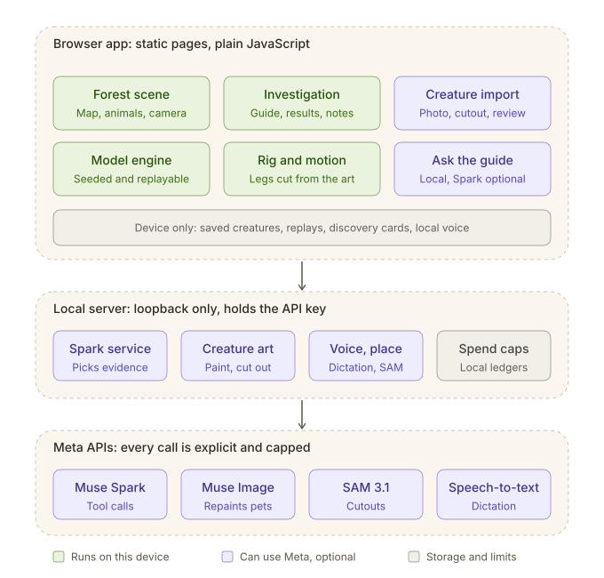

# Microverse

An illustrated ecosystem playground: bring a creature to life, predict what an environmental change will do, and compare repeatable model experiments.

Start with **A dry spell begins**, the replayable guided investigation, or visit **My creatures** to save a reviewed companion on this browser. Investigations now show one forest with an optional reference/split view, plain-language food comparisons, recorded-event close-ups and an everyday reflection. See [the experience guide](docs/guided-discovery.md) and [initial curriculum correspondence check](docs/curriculum-review.md).

This public repository is being assembled one feature at a time. The living forest supports complete snapshots, paired experiments and downloadable replay with creature images and learner notes. Prepared ecology questions, manual changes, a traceable evidence guide and a printable classroom activity work without AI calls. Optional Meta creature and Spark bridges are disabled by default. The classroom activity follows **predict → experiment → inspect → explain** to explore indirect ecological effects; teacher/learner usability sessions remain pending.



The diagram is generated from [docs/architecture.drawio](docs/architecture.drawio), which opens and edits in [diagrams.net](https://app.diagrams.net).

## Development

Use Node.js 24 or newer. The browser/simulation has no package runtime dependencies; the optional local server uses the pinned official SAM parser and Kokoro runtime for neural narration.

```sh
npm ci --ignore-scripts
npm test
npm run check
npm run preview
npm run build
```

Feature branches and pull requests carry their own tests, limitations, and provenance. See [development workflow](docs/development.md), [migration sequence](docs/migration.md), and [classroom design](docs/classroom.md).

The [indirect contributions plan](docs/indirect-contributions.md) specifies how to evaluate reasoning skills and make the engine, replay format and puppet tools useful to other builders.

Run `npm run preview:motion` for the local [motion workbench](docs/motion.md). The [UI boundary guide](docs/ui-boundaries.md) keeps the eventual product layout open to redesign while retaining tested model and animation logic.

The [living forest guide](docs/forest.md) documents the current interaction, browser checks, asset provenance and remaining limits. The UI draft is intentionally changeable.

The [replay guide](docs/replay.md) describes the complete snapshot format, reproducibility checks, local file handling and limits of the ten random-continuation runs. Choose **Less rain** or **Remove wolves** in the forest; reopen saved files from **Field notes → Open a saved experiment**.

The [Meta creature bridge guide](docs/meta-creature.md) describes `npm run preview:meta`, local cutting, accessory-preserving prompts, cost reservations and the live image checks still outstanding. No generation happens with default configuration.

The [four-photo pilot](docs/image-pilot.md) records actual Meta outputs, a corrected harness-mask failure, geometry checks and remaining likeness/motion/replay work. Photo-derived outputs stay private; this is a small pilot, not a reliability benchmark.

Choose **Ask “what if?”** for six prepared questions or a supported manual change. The [investigation guide](docs/investigation.md) documents the optional Spark proposal/evidence adapters, exact change approval, funding settings, live verification and limits. Meta Spark has passed a live custom-proposal check. Baseten transport was tested; a later numeric interpretation error keeps that optional provider paused pending correction and revalidation. Open `/teacher.html` for the printable activity and observation sheet.

**Narration: On** adds model-derived captions. Read aloud separately opts into local Kokoro Heart neural speech, with no hosted inference charge or device-voice fallback. **Speak a question** adds review-before-send Meta dictation and an editable transcript; it never runs an experiment automatically. See [voice setup, costs and verified limits](docs/narration.md).

The [resource-use guide](docs/resource-use.md) records where inference is optional, existing reuse limits, and environmental claims we cannot yet support. The teacher guide includes an optional discussion connecting the experiment to a familiar place and examining the tool’s own resource use.

Choose **Place photo** to inspect reviewed SAM image shares and explicitly choose starting food while retaining your creatures and fixed map. A labelled recorded example needs no inference. See [place measurements and limits](docs/places.md) and the [short demo/evidence checklist](docs/demo.md).

## Focused game experience study

Open `/forest-story.html` to try the four-scene lesson prototype: meet a rabbit, predict, watch a real model-food change and reflect. `/examples/forest/story-frames.html` shows the four frames together; `/examples/forest/animal-acting.html` reviews grounded fox motion. These are separate review surfaces; the existing forest remains available. See [the prototype scope and checks](docs/forest-story-prototype.md).

## Entrance and reusable tools

Open `/storyboard.html` for the layered watercolor entrance, then `/behind.html` for the craft/resource explanation and `/build-with.html` for reusable source. The entrance uses cached local fox/fawn poses and a licensed photo with its actual Meta illustration; see [verification and art notes](docs/entrance-polish.md).

The original project code is [MIT-licensed](LICENSE). Artwork, model services and upstream dependencies retain their own terms; see [THIRD_PARTY.md](THIRD_PARTY.md). Three independent MIT source repositories have examples and tests that run without API keys:

- [microverse-ecosystem](https://github.com/S2800-0/microverse-ecosystem): deterministic model, complete state and experiment replay.
- [microverse-puppets](https://github.com/S2800-0/microverse-puppets): local cutout fitting, procedural motion and rig review, with a browser example.
- [microverse-commands](https://github.com/S2800-0/microverse-commands): prepared questions and bounded, reviewable experiment proposals.

These are extracted prototypes, not npm registry releases or externally validated tools.

## Provenance and event contributions

Pre-event experiments exist in a separate local prototype. Imported work is recorded in [PROVENANCE.md](PROVENANCE.md), with its original path and source hash. An import date does not make old work newly developed. The final submission must identify eligible new event contributions separately and follow organizer clarification on reuse.

Simulation output describes a simplified model. Natural-history facts, tuned model assumptions, generated imagery, and observed real-world measurements must remain distinguishable. This project does not currently provide environmental forecasts or evidence of improved learning outcomes.
