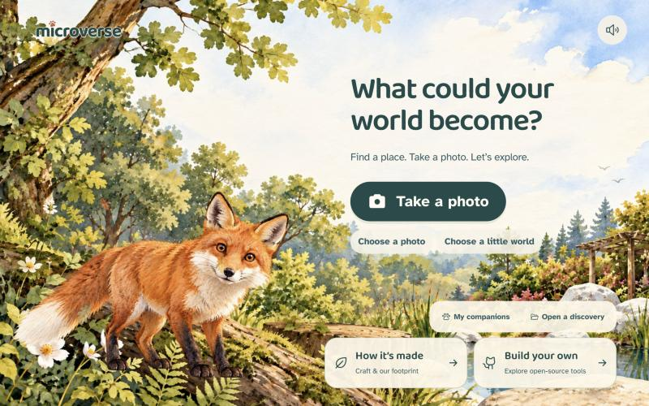
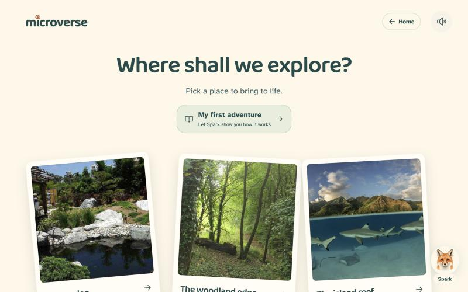
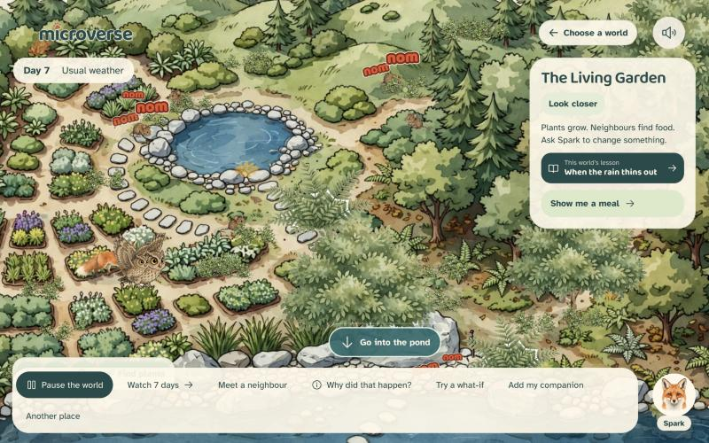
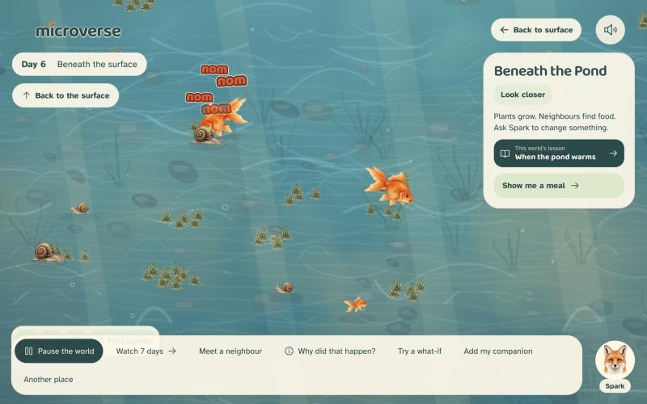
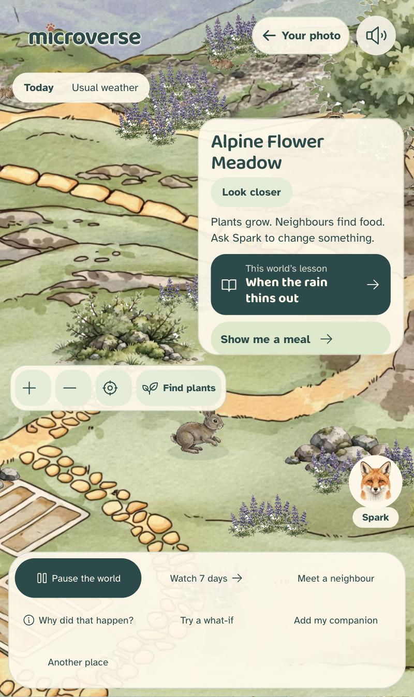
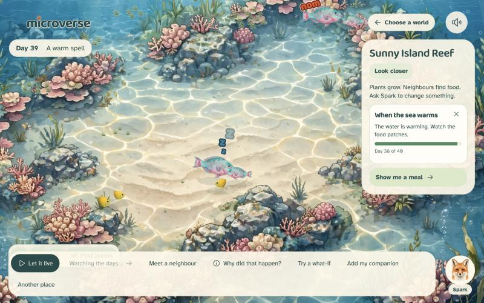
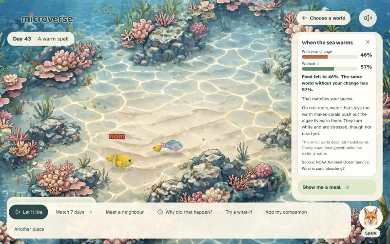
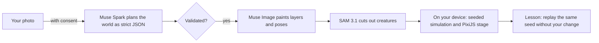

<div align="center">

# Microverse

**Turn a photo of a real place into a living little world, then change one thing and see what happens.**

[](https://github.com/S2800-0/microverse/actions/workflows/ci.yml)
[](LICENSE)
[](docs/SUBMISSION.md)

[How it works](#how-it-works) · [Run it](#run-it) · [Open source tools](#open-source-tools)



</div>

Microverse is a playful ecology sandbox for curious kids, built for the Meta Global AI Developer Hackathon. Ecology is about connections, and connections are hard to see in a real place. You can't make it rain less over your local park and watch what happens. In Microverse, you can try that on a small model inspired by the place.

## See it

| Choose a place | Watch it live |
|---|---|
|  |  |
| **Go beneath the surface** | **Make a world from a photo** |
|  |  |
| **Try one change** | **Compare it fairly** |
|  |  |

## What you can do

- **Make a world from a photo.** Muse Spark looks at your photo and designs a world, keeping what it can see separate from what it is guessing. Muse Image paints the ground, creatures and scenery as separate layers.
- **Watch it live.** Plants grow and get eaten. Animals walk, eat, sleep and chase, with "nom nom nom" stickers and rising z's. Land animals keep to walkable ground.
- **Run a fair test.** Every world has a lesson that fits its habitat. Guess what will happen, make one change and watch 40 days. Microverse then replays the same world from the same start without your change and shows both results side by side, with a named source for the real-world science.
- **Talk to Spark.** Spark, a fox guide, answers common questions for free from what actually happened in the world, and turns typed requests into checked changes.
- **Bring a pet.** A photo of an animal can become a watercolor companion who visits your world.

| World | Lesson | Source |
|---|---|---|
| The garden | When the rain thins out | [NOAA and NIDIS](https://www.drought.gov/what-is-drought/ecological-drought) |
| The woodland edge | How many can this place feed? | [Wikipedia](https://en.wikipedia.org/wiki/Carrying_capacity) |
| The island reef | When the sea warms | [NOAA](https://oceanservice.noaa.gov/facts/coral_bleach.html) |
| Beneath the pond | When the pond warms | [USGS](https://www.usgs.gov/special-topics/water-science-school/science/temperature-and-water) |

## How it works



The AI designs a world once. After that the world runs, replays and compares on your device with no further AI calls.

| Meta model | Job in Microverse |
|---|---|
| **Muse Spark 1.3** | Plans each world from the photo, chooses a lesson from a fixed menu, turns typed requests into validated commands, and answers custom questions from recorded events |
| **Muse Image 1.0** | Paints terrain, creature sheets, scenery, drawn poses and pet companions |
| **SAM 3.1** | Cuts creatures out of their paintings so they can move as layers |

### Under the hood

- **Replayable simulation:** seeded, with a full record of every change. That is what makes the same-world comparison possible.
- **Layered stage:** PixiJS, with separate water, plant, canopy and flight layers.
- **Drawn motion:** legs are found from each drawing's shape, then one drawing is bent with a mesh, so it walks without flipping between images.
- **Walkable ground:** a grid computed on the device from the painting's colours, with route-finding around obstacles.
- **Guard rails:** strict schemas around every model reply, consent before a photo is sent, spending caps and no automatic retries.

## Run it

You need [Node.js](https://nodejs.org/) 24 or newer.

```bash
git clone https://github.com/S2800-0/microverse.git
cd microverse
npm install
npm run dev
```

The saved worlds, lessons and prepared Spark answers all work with no API key. Open a world, then press **This world's lesson**.

### Turning on AI features

Making new worlds and AI Spark replies run on the local dev server, using your own Meta Model API key. They stay off until you set up both of these:

1. Copy `.env.example` to `.env` and add your key.
2. Create `runtime/expansion-permit.json`, which sets a spending cap and an end date. The cap must match `APPROVED_TEST_CAP_MICRO_USD` in [`server/expansion-access.mjs`](server/expansion-access.mjs), in millionths of a dollar:

```json
{"capMicroUsd": 5000000, "expiresAt": "2030-01-01T00:00:00Z"}
```

Requests are capped and never retried automatically. A static build has no server, so it has saved worlds and lessons only.

The optional on-demand voice also needs a local Kokoro model in `runtime/kokoro-model/`. Prepared voice clips work without it.

To run the tests, build first, because the packaging test checks the build output:

```bash
npm run build
npm test
```

## Project layout

| Path | What's there |
|---|---|
| `src/world/` | The living world: simulation, PixiJS stage, motion, water, walkable ground, lessons |
| `src/core/` | Shared engine pieces: creatures, rigs, scenes, replay |
| `src/experience/`, `src/components/` | App screens and journeys |
| `src/spark/` | Spark, the fox guide |
| `server/` | Local AI routes, validation and spending caps |
| `tests/` | Automated tests |
| `docs/` | [Submission notes](docs/SUBMISSION.md), [credits](docs/CREDITS.md), [AI system map](docs/AI-SYSTEM-MAP.md), [development log](docs/DEVELOPMENT-LOG.md) |

## Honest limits

- Microverse is a teaching model. It doesn't predict any real place, and its rules are simplified.
- It hasn't been tested with children or teachers, so it makes no claim about learning results. Real phones and touch haven't been tested either.
- Lesson cards are short notes in our own words. The AI doesn't write or verify them.
- Paths come from a colour rule on the painting, not from AI understanding of the scene. Woodland paths are still rough.
- Water is a picture effect, not a fluid simulation. Leg motion is artistic, not a measured gait.

## Open source tools

Three parts of Microverse are available as small standalone libraries. Each is MIT licensed, has no runtime dependencies and needs no API key.

| Tool | What it does |
|---|---|
| [**microverse-ecosystem**](https://github.com/S2800-0/microverse-ecosystem) | A toy ecology engine with complete snapshots and exact replay |
| [**microverse-puppets**](https://github.com/S2800-0/microverse-puppets) | Turns a transparent cutout of a four-legged animal into a walking puppet, in the browser |
| [**microverse-commands**](https://github.com/S2800-0/microverse-commands) | Turns ecology questions and model replies into strictly checked experiment proposals |

## Project history

This repository's history starts on the hackathon's first day. The earlier app's commits and pull requests are all kept, and the current app joins them in a merge commit. See ["Built during the event"](docs/SUBMISSION.md#built-during-the-event) for what came from where.

## Contributing

Issues and pull requests are welcome. See [CONTRIBUTING.md](CONTRIBUTING.md).

## Credits and license

Code and documentation are [MIT licensed](LICENSE). Photos, artwork, music, fonts and voices keep their own terms, listed in [docs/CREDITS.md](docs/CREDITS.md).

The island reef photo's photographer hasn't been identified yet, so it isn't covered by the MIT licence. If it's yours, see [the credits](docs/CREDITS.md#a-photo-still-to-be-credited). The woodland photo is by Derek Harper (CC BY-SA 2.0). Built by Shahesta Salama.
